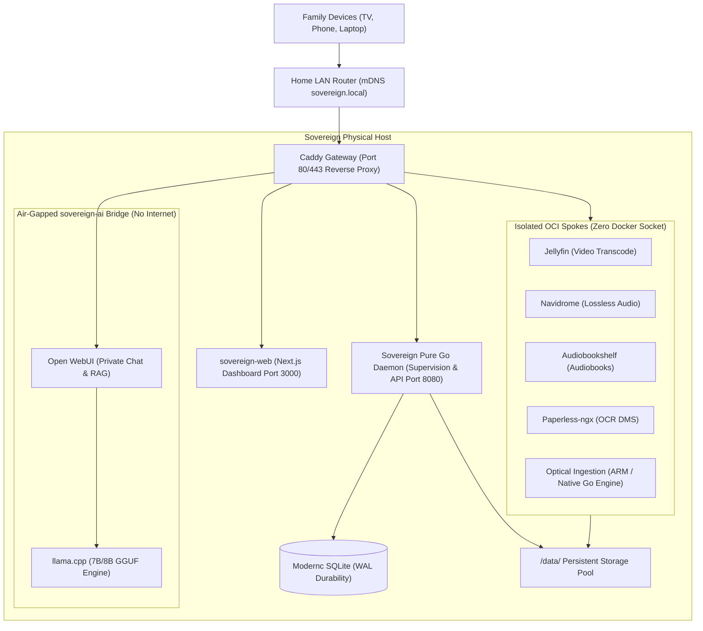

# Sovereign: The 100% Private Self-Hosted Home Appliance

[](LICENSE)
[](https://github.com/j333c/sovereign)
[](#zero-telemetry-privacy-invariants)
[](#bmad-method-attribution)
[](#transparent-ai-assisted-development-notice)

**Sovereign** transforms standard consumer hardware (from an ultra-low-power Intel N100 mini-PC to high-end workstations) into a private, self-hosted, appliance-grade household server. It replaces fragmented proprietary cloud subscriptions with unified, beautiful, and autonomous local spokes—engineered with zero external telemetry, air-gapped AI inference, and atomic crash resilience.

---

## Key Highlights & Spoke Capabilities

1. **4K Video Streaming & Transcoding (Jellyfin)**: Hardware-accelerated tone mapping with Intel QuickSync / VA-API. Streams 4K HDR media smoothly to smart TVs, tablets, and phones without cloud subscription fees.
2. **Lossless Music & Audiobooks (Navidrome & Audiobookshelf)**: Bit-perfect 24-bit FLAC streaming compatible with the Subsonic API (DSub, Symfonium, Amperfy), alongside multi-user audiobook listening progress and chapter sync.
3. **Intelligent Document Archival (Paperless-ngx)**: Automated Tesseract OCR text indexing, encrypted IMAP email ingestion, and intelligent household contract cancellation & payment deadline detection.
4. **Local Private AI & Instant Document RAG (llama.cpp & Open WebUI)**: High-performance 7B/8B GGUF model inference executed on an air-gapped internal bridge network. Chat directly with your digitized paperwork with zero cloud data leakage.
5. **Autonomous Optical Disc Ingestion (Automatic Ripping Machine / ARM)**: Headless udev disc detection. Insert an audio CD, DVD, or Blu-ray, and the appliance rips media losslessly, queries artwork metadata, and ejects the tray automatically.

---

## Architectural Invariants & Privacy Guarantees

Sovereign is built around four uncompromising architectural invariants:

- **🔒 Air-Gapped AI Network (`sovereign-ai`)**: The LLM inference engine runs on an isolated internal Docker bridge with no default internet gateway or external routing. Prompts, vector embeddings, and personal documents never leave physical appliance storage.
- **🛡️ Zero Docker Socket Exposure**: Application containers run strictly unprivileged with zero mounts to `/var/run/docker.sock`. Spoke services cannot inspect or manipulate other workloads, preventing container escape attacks.
- **💾 CGO-Free WAL Durability**: The central orchestration supervisor is implemented in pure Go using `modernc.org/sqlite` with Write-Ahead Logging (WAL) and synchronous disk durability. The appliance withstands sudden power cuts without database corruption.
- **⏱️ Atomic 180s Health Verification & Rollback**: Automatic and manual service upgrades take pre-upgrade volume snapshots and probe health endpoints for 180 seconds. Any crash or degradation triggers an immediate, atomic rollback to prior working revisions without data loss.

---

## Architecture Overview



---

## Hardware Specification Tiers

Sovereign supports three standard hardware profiles designed for different household needs:

| Tier Profile | Target Workload | Minimum Specs | Storage & Idle Power |
|---|---|---|---|
| **Light Tier** | DMS Archival + Lossless Music | Dual-core x86 or ARM64 (Intel N100, RPi 5) · 4 GB RAM | 64 GB SSD (OS) + 500 GB · **5W–10W idle** |
| **Media Tier** | Video Transcode + Audio + DMS + Disc Rip | Quad-core x86 w/ Intel QuickSync · 8 GB RAM | 128 GB NVMe + 2–8 TB Pool · **10W–25W idle** |
| **AI & Power Tier** | Local 7B/8B LLM RAG + All Media & DMS | 6+ Core CPU · 16–32 GB RAM · RTX 3060/4060 or unified APU | 256 GB NVMe + 4–16 TB Pool · **25W–45W idle** |

Detailed guides and bill-of-materials recommendations are available in [docs/hardware/TIERS.md](docs/hardware/TIERS.md) and [docs/hardware/ROADMAP.md](docs/hardware/ROADMAP.md).

---

## Quickstart & Installation

Sovereign is publicly available on GitHub at [https://github.com/j333c/sovereign](https://github.com/j333c/sovereign).

### 🚀 Turnkey One-Line Linux Installation (Recommended)

To install Sovereign on any clean Linux machine (Ubuntu, Debian, Fedora, or Arch on x86_64 or ARM64), paste this single line into your terminal:

```bash
curl -fsSL https://raw.githubusercontent.com/j333c/sovereign/main/install.sh | sudo bash
```

**What the installer does automatically:**
1. Validates system requirements (architecture, OS, $\ge 4\text{ GB}$ RAM, $\ge 20\text{ GB}$ storage).
2. Provisions official Docker Engine & Docker Compose v2 if not already present.
3. Deploys the Sovereign release from GitHub to `/opt/sovereign`.
4. Initializes persistent partitioned storage under `/data`.
5. Enables and starts the `sovereign.service` systemd unit for automatic startup on machine boot.
6. Opens required firewall ports (`80/tcp`, `443/tcp`, `5353/udp`).
7. Displays your local access URL (`http://sovereign.local` or direct LAN IP).

*To run unattended without confirmation prompts, pass `-y`:*
```bash
curl -fsSL https://raw.githubusercontent.com/j333c/sovereign/main/install.sh | sudo bash -s -- --yes
```

---

### 🛠️ Alternative: Manual Git Clone & Development Setup

Developers or users configuring custom environments can clone the repository directly:

```bash
git clone https://github.com/j333c/sovereign.git
cd sovereign
docker compose up -d
```

---

### 🌐 Local Network Discovery & First-Run Setup Wizard

Once installed and running:
1. Open any browser on your home Wi-Fi and navigate to:
   ```
   http://sovereign.local
   ```
   *(If your network does not resolve mDNS, check your router's DHCP client list for the IP address assigned to `sovereign` and browse to `http://<ip-address>`)*.
2. Complete the 5-step onboarding wizard:
   - **Language Selection**: English, German, Spanish, or French.
   - **Network Verification**: Local hostname confirmation and mDNS validation.
   - **Storage Configuration**: Local disk pool formatting or household NAS mount (SMB/NFS).
   - **Feature Activation**: Enable desired spokes (Streaming, Audio, OCR, Private AI, Disc Ingestion).
   - **Master Admin Credentials**: Set your appliance administrative password.

---

## Multilingual Support & Documentation

Sovereign is localized with 100% string and documentation parity across four launch languages:
- **English**: [docs/guides/en/GUIDES.md](docs/guides/en/GUIDES.md)
- **German (Deutsch)**: [docs/guides/de/ANLEITUNGEN.md](docs/guides/de/ANLEITUNGEN.md)
- **Spanish (Español)**: [docs/guides/es/GUIAS.md](docs/guides/es/GUIAS.md)
- **French (Français)**: [docs/guides/fr/GUIDES.md](docs/guides/fr/GUIDES.md)

Interactive in-browser documentation and feature showcases are accessible directly at:
- **Feature Showcase**: `http://sovereign.local/landing`
- **Guides & Troubleshooting**: `http://sovereign.local/guides`
- **Hardware Tier Calculator**: `http://sovereign.local/hardware`

---

## BMad Method Attribution

Sovereign was planned, architected, specified, and implemented utilizing the **BMad Method**—a systematic, iterative software engineering framework for high-assurance, durable, and resilient application development.

- **Requirements & PRD Formulation**: Structured stakeholder elicitation, user stories, and strict appliance-grade non-functional requirements.
- **Architecture Spine**: System boundary definition, CGO-free invariants, decoupled containerization, and zero-telemetry boundary enforcement.
- **Spec-Driven Story Delivery**: Every epic and story implemented with frozen user intent, baseline commit tracking, multi-perspective adversarial code reviews (Blind Hunter, Edge Case Hunter, Verification Gap Reviewer), triaged remediations, and 100% automated test verification.

---

## Transparent AI-Assisted Development Notice

In accordance with open-source transparency principles:
- **AI-Assisted Pair Programming**: Substantial parts of Sovereign's code, test suites, and documentation were authored and refined using advanced autonomous AI coding models operating under continuous human oversight.
- **Deterministic Verification**: No AI-generated code is accepted into Sovereign without 100% passing automated test suites (`go test ./...` and `npm --prefix web test`), strict architectural linter validation, and rigorous adversarial review loops.
- **Human Architectural Ownership**: System invariants, security models, microcopy reassurance, and licensing choices are governed by human maintainers.

---

## Open-Source Licensing & Attribution

Sovereign's host daemon, orchestrator, and web frontend are licensed under the **Apache License 2.0**. See [LICENSE](LICENSE) for details.

All bundled spoke applications are celebrated open-source projects licensed under their respective original terms without proprietary restrictions:
- **Jellyfin**: GNU General Public License v3.0 (GPLv3)
- **Navidrome**: GNU General Public License v3.0 (GPLv3)
- **Audiobookshelf**: GNU General Public License v3.0 (GPLv3)
- **Paperless-ngx**: GNU General Public License v3.0 (GPLv3)
- **Open WebUI**: MIT License
- **llama.cpp**: MIT License
- **Caddy**: Apache License 2.0
- **Automatic Ripping Machine (ARM)**: MIT License / GPLv2

Full upstream copyright notices, attribution disclosures, and container boundary statements are cataloged in [LICENSES.md](LICENSES.md).

---

## Contributing & Community Governance

We welcome community contributions, bug reports, and hardware profile test results!
- **Contributing Guidelines**: [CONTRIBUTING.md](CONTRIBUTING.md)
- **Project Governance**: [GOVERNANCE.md](GOVERNANCE.md)
- **Security & Vulnerability Reporting**: [SECURITY.md](SECURITY.md)
