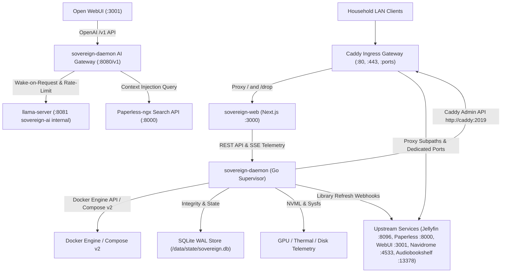

# Architecture Spine — Sovereign

## Design Paradigm

Sovereign is built on the **Supervised Hub-and-Spoke** paradigm. A lightweight, privileged supervisor daemon (`sovereign-daemon`) acts as the appliance control plane hub, while user-facing upstream applications (Jellyfin, Navidrome, Audiobookshelf, Paperless-ngx, Open WebUI, llama-server, Automatic Ripping Machine) operate as managed container spokes. The frontend (`sovereign-web`) is a strictly decoupled presentation client with zero direct access to the host operating system or Docker engine socket.

### Namespace & Layer Mapping

- `/cmd/sovereign-daemon`: Supervisor daemon binary entrypoint, HTTP/SSE routing, CLI flags.
- `/internal/supervisor`: Container lifecycle management, Docker Compose v2 SDK engine integration, healthcheck monitoring, pre-upgrade database snapshotting, and atomic rollback state engine.
- `/internal/hardware`: Hardware telemetry sensors (NVML GPU metrics, Intel/AMD DRM sysfs, thermal, CPU, memory, SMART storage), GPU idle surrender ticker (300s).
- `/internal/ai`: AI Gateway & mediation proxy, Two-Lane Priority Request Governor, wake-on-request lazy loader, Safe Stub HTTP 503 responder, Paperless context injection.
- `/internal/storage`: Structured `/data` hierarchy manager, media dropzone staged file validation, atomic ingestion file mover, scheduled off-peak transcoding queue runner.
- `/internal/ingress`: Caddy Admin API client (`http://caddy:2019`) for dynamic route table synchronization and SSL certificate management.
- `/internal/auth`: Argon2id credential hashing, secure HTTP-only session cookie authentication, RBAC authorization for admin endpoints.
- `/internal/store`: Embedded SQLite database engine (`/data/state/sovereign.db`) operating in WAL mode with schema migration management.
- `/web`: Next.js frontend application (App Router, React 19, Tailwind CSS, shadcn/ui component library, Zod client boundary schemas).

---

## Inherited Invariants

| Inherited | From Parent | Binds Here |
| --- | --- | --- |
| ADR-001 | PRD Architecture Decisions | Managed `llama.cpp` (`llama-server`) using direct GGUF files in `/data/models`, exposing OpenAI-compatible `/v1` endpoint. |
| ADR-002 | PRD Architecture Decisions | Document RAG using Paperless-ngx document search API and content extraction for direct prompt injection; zero redundant vector DB. |
| ADR-003 | PRD Architecture Decisions | GPU resource arbitration via ingestion direct-play pre-encoding, daytime AI priority, and 5-minute dynamic idle VRAM surrender. |
| ADR-004 | PRD Architecture Decisions | Appliance Boundary Guard Suite: safe HTTP 503 stub mode on missing models, GGUF magic check, `-np 2` concurrency sizing, air-gapped operation. |

---

## Invariants & Rules



### AD-1 — Dedicated Go Core Daemon & Decoupled Next.js Client [ADOPTED]

- **Binds:** Appliance control plane, Web UI client, container engine integration.
- **Prevents:** Web UI lifecycle crashes killing background supervisors, or exposing `/var/run/docker.sock` to the web presentation container.
- **Rule:** The web presentation container (`sovereign-web`) must never mount `/var/run/docker.sock` or invoke host shell processes. All system mutations, telemetry reads, and container operations must execute strictly via HTTP REST and SSE requests to `sovereign-daemon`.

### AD-2 — Declarative Compose v2 with Snapshot-Backed Atomic Rollback [ADOPTED]

- **Binds:** Service deployment, update lifecycle, container state configuration, database schema state.
- **Prevents:** Partial container startup, broken image updates stranding the appliance in an unbootable state, configuration drift, and incompatible forward database migrations during downgrade.
- **Rule:** All managed services must be declared in versioned compose specifications (`/data/state/compose/rev-:rev.yaml`). Before applying an update, `sovereign-daemon` must create an atomic SQLite snapshot (`/data/state/backups/pre-upgrade-:rev.db`). Container state transitions must pass container healthchecks across a 180-second verification window with watchdog debouncing (minimum 3 consecutive failures over 60s); any healthcheck failure must automatically trigger an atomic rollback to `rev-:prev_rev` and restore the pre-upgrade database snapshot.

### AD-3 — Dedicated Caddy Gateway for Dual-Path Ingress and Dynamic SSL [ADOPTED]

- **Binds:** Network ingress, routing, SSL certificates, Caddy administration.
- **Prevents:** Incompatible port vs. subpath client routing, path rewriting bugs in upstream media/chat applications, manual TLS configuration complexity, and inter-container Admin API addressing failures.
- **Rule:** Ingress is handled exclusively by a dedicated Caddy container. Upstream services must be reachable via both dedicated ports (e.g. `:8096`, `:8000`, `:3001`, `:4533`, `:13378`) and standard subpaths (e.g. `/media`, `/docs`, `/chat`, `/music`, `/audiobooks`) using Caddy `handle_path` prefix trimming and `X-Forwarded-Prefix` headers. The Go daemon must manage Caddy routes and SSL certificates (custom upload, Let's Encrypt/ACME, or internal CA) dynamically via `http://caddy:2019` over the `sovereign-control` network.

### AD-4 — Network Segregation & Mediated AI Gateway [ADOPTED]

- **Binds:** Docker networking, security boundaries, LLM inference, dynamic GPU surrender.
- **Prevents:** Direct unauthenticated LAN access to raw LLM server, database instances, daemon control sockets, and silent idle surrender deadlocks.
- **Rule:** Containers must be partitioned into three Docker bridge networks: `sovereign-ingress` (Caddy, Web UI, Daemon public API, upstream frontends), `sovereign-control` (Daemon, Caddy Admin API, Docker socket), and `sovereign-ai` (Daemon, Open WebUI, llama-server). Open WebUI must route all `/v1` requests through `sovereign-daemon:8080/v1` (the AI Gateway). The AI Gateway arbitrates request priority (human chat vs. background extraction), manages wake-on-request cold starts, checks GGUF model headers, responds with HTTP 503 Safe Stub when models are absent, and unloads VRAM after 300 seconds of inactivity. Raw `llama-server` is strictly internal to `sovereign-ai` and must never publish host ports.

### AD-5 — Structured /data Layout & SQLite WAL Durability [ADOPTED]

- **Binds:** Storage volumes, database configurations, power-loss resilience.
- **Prevents:** Scattered files, database corruption during unexpected household power disconnection, and cross-volume file copy latency.
- **Rule:** Host storage must be partitioned under a single `/data` mount (`/data/media`, `/data/documents`, `/data/models`, `/data/state`, `/data/drop`). All SQLite databases (including `sovereign.db` and Paperless) must enforce `PRAGMA journal_mode = WAL;` and `PRAGMA synchronous = NORMAL;`.

### AD-6 — Tiered Boot Lifecycle & Unclean Shutdown Diagnostics [ADOPTED]

- **Binds:** Boot lifecycle, diagnostics screen, recovery orchestration, ingress availability.
- **Prevents:** Running applications on corrupted state post-outage, or presenting users with connection errors during boot diagnostics.
- **Rule:** Clean shutdowns must write `clean_shutdown = true` to `/data/state/boot_state.json`. On system startup, the Appliance Core tier (`sovereign-daemon`, `caddy`, `sovereign-web`) starts immediately. If `clean_shutdown` is missing or false, `sovereign-daemon` enters `DiagnosticsMode`, locking the Web UI to `/boot` via `/api/system/boot-status` while running `PRAGMA integrity_check` on all SQLite databases and volume journal checks. Upstream application containers (Tier 2) are launched only after diagnostics verify system integrity.

### AD-7 — Staged Dropzone Ingestion with Instant Refresh Webhooks [ADOPTED]

- **Binds:** Standalone Dropzone (`/drop`), file organization, media server libraries.
- **Prevents:** In-flight partial upload consumption, corrupt 0-byte media library indexing, and execution of non-media payloads.
- **Rule:** Uploads must stream to a temporary staging file at `/data/drop/incoming/:category/.uploading-:uuid-:filename`. Upon complete stream closure and `fsync()`, the file is atomically renamed to `:filename` in the staging folder, validated for media signature magic bytes, and atomically moved (`os.Rename`) into `/data/media/:category`. Upon move completion, `sovereign-daemon` must trigger immediate HTTP library refresh webhooks to Jellyfin, Navidrome, or Audiobookshelf.

### AD-8 — API Contract & Real-Time Telemetry via OpenAPI and SSE [ADOPTED]

- **Binds:** Daemon-frontend communication, telemetry streams, client generation.
- **Prevents:** Frontend/backend contract drift, type mismatches, and polling latency.
- **Rule:** All daemon endpoints must be documented in a single OpenAPI 3.1 specification. The frontend TypeScript API client must be strictly generated from this spec. Real-time telemetry (CPU, GPU, thermal, disk, service states) must stream exclusively via Server-Sent Events (`/api/events`), eliminating UI polling.

### AD-9 — Role-Based Access Control & Session Authentication [ADOPTED]

- **Binds:** System security, user access control, administrative endpoints.
- **Prevents:** Unauthenticated household members executing destructive administrative actions or altering system configuration.
- **Rule:** The first-run setup wizard must provision an administrator password, stored as an Argon2id hash in `sovereign.db`. Public LAN endpoints are strictly limited to `/` (read-only dashboard telemetry and service launcher cards), `/drop` (file upload), and `/boot` (diagnostic status). All destructive endpoints (`/settings`, `/api/v1/admin/*`, service restarts, rollbacks, model swaps, and TLS cert uploads) require an authenticated session backed by an `HttpOnly`, `SameSite=Strict` cookie.

---

## Consistency Conventions

| Concern | Convention |
| --- | --- |
| Naming (entities) | PascalCase for UI components and Go structs (e.g., `ServiceCard`, `ModelManifest`). |
| Naming (files) | kebab-case for frontend modules and backend source files (e.g., `service-card.tsx`, `compose-supervisor.go`). |
| Naming (routes) | `/api/v1/:resource` in lowercase kebab-case (e.g., `/api/v1/services`, `/api/v1/telemetry`, `/api/v1/models`). |
| Naming (events) | `domain.action` format for SSE and system log events (e.g., `gpu.idle_surrender`, `storage.disk_alert`, `service.health_changed`). |
| Data & Formats (IDs) | UUIDv7 for persistent database entities; standard lowercase slugs for service identifiers (e.g., `jellyfin`, `paperless`). |
| Data & Formats (Timestamps) | ISO 8601 UTC strings (`YYYY-MM-DDTHH:mm:ssZ`). |
| Error Shapes | RFC 7807 Problem Details (`{"type": string, "title": string, "status": int, "detail": string, "instance": string}`). |
| State Mutation | All destructive actions (restart, rollback, model switch) require HTTP POST/PUT with explicit request payloads and CSRF protection. |
| Configuration Sync | File writes to `/data/state/` must use atomic temp-file write, `fsync()`, and atomic rename. |
| Staging File Suffix | In-flight uploads must use `.uploading-:uuid-:filename` and never be indexed by media workers until finalized. |

---

## Stack

| Name | Version |
| --- | --- |
| Go | 1.27.2 |
| Node.js | 24.22.0 |
| Next.js | 16.4.1 |
| React | 19.0.0 |
| Tailwind CSS | 4.0.0 |
| Caddy | 2.11.7 |
| SQLite | 3.54.0 |
| Docker Compose | 2.32.4 |
| Jellyfin | 12.2.0 |
| Navidrome | 0.54.5 |
| Audiobookshelf | 2.19.5 |
| Paperless-ngx | 3.3.1 |
| Open WebUI | 0.12.0 |
| llama.cpp | b11647 |
| Automatic Ripping Machine | 2.24.4 |

---

## Structural Seed

```text
sovereign/
├── cmd/
│   └── sovereign-daemon/       # Go supervisor entrypoint
├── internal/
│   ├── ai/                     # AI Gateway, two-lane priority governor, idle timer, safe stub
│   ├── auth/                   # Argon2id password hashing, session tokens, RBAC middleware
│   ├── hardware/               # GPU NVML, sysfs thermal, and disk SMART monitoring
│   ├── ingress/                # Caddy Admin API client and SSL management
│   ├── storage/                # Staged dropzone validation, atomic library file movers, transcoding queue
│   ├── store/                  # SQLite WAL state store, migrations, pre-upgrade snapshots
│   └── supervisor/             # Docker Compose SDK, healthcheck engine, atomic rollback
├── web/
│   ├── app/                    # Next.js App Router (dashboard, drop, settings, setup, boot)
│   ├── components/             # shadcn/ui components, telemetry bars, service cards
│   └── lib/                    # Generated OpenAPI client, Zod schemas, SSE hooks
└── compose/
    └── templates/              # Base service compose templates (jellyfin, paperless, etc.)
```

---

## Capability → Architecture Map

| Capability / User Journey | Lives in | Governed by |
| --- | --- | --- |
| UJ-1 First-run setup & video streaming (Alex) | `/web/app/setup`, `/internal/supervisor` | AD-1, AD-2, AD-3, ADR-003 |
| UJ-2 Document intake, OCR & deadline alerts (Elena) | `/internal/supervisor`, `/internal/storage`, `/internal/ai` | AD-4, AD-9, ADR-002 |
| UJ-3 Family media dropzone & photo/music intake | `/web/app/drop`, `/internal/storage` | AD-5, AD-7 |
| UJ-4 Sudden power-loss resilience (Marcus) | `/internal/store`, `/internal/supervisor` | AD-5, AD-6 |
| UJ-5 Automated physical disc digitization & transcoding | `/internal/storage`, `/internal/supervisor` | AD-2, AD-7, ADR-003 |

---

## Deferred

| Item | Reason for Deferral |
| --- | --- |
| Multi-node clustering & high availability | Sovereign is specifically designed as a single-household physical/virtual appliance; clustering introduces distributed consensus complexity unnecessary for single homes. |
| Distributed object storage (Ceph / MinIO) | Single POSIX filesystem on `/data` is simpler, avoids database overhead, and supports instant zero-copy atomic file renames. |
| Remote WAN VPN / Cloudflare Tunnels | Out of scope for v1 appliance core; initial priority is robust local network mDNS discovery and privacy-first local operation. |
| Dynamic kernel module compilation (ZFS DKMS) | Ext4 and Btrfs provide sufficient journaling and snapshotting capabilities without requiring custom kernel module compilation or packaging. |
