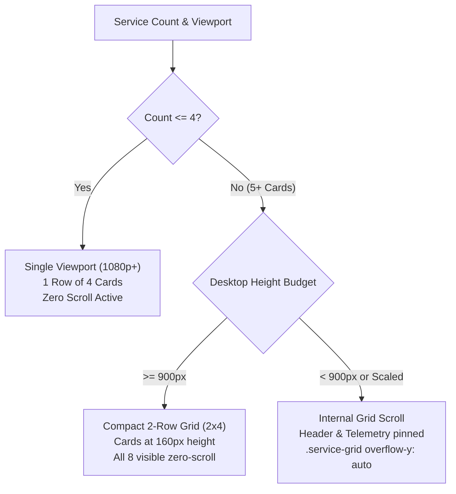

# UX Review: Responsive Behaviors & Viewport Constraints

**Reviewer**: UX Responsive & Viewport Specialist  
**Target Workspace**: `_bmad-output/planning-artifacts/ux-designs/ux-sovereign-2026-10-15`  
**Documents Evaluated**: [`DESIGN.md`](DESIGN.md), [`EXPERIENCE.md`](EXPERIENCE.md), [`mockups/dashboard.html`](mockups/dashboard.html), [`mockups/dropzone.html`](mockups/dropzone.html), [`mockups/settings.html`](mockups/settings.html)  
**Date**: 2026-10-15  

---

## 1. Executive Summary & Viewport Conformance Scorecard

This evaluation audits the viewport mechanics, container physics, touch accessibility, and breakpoint consistency across the Sovereign UX specification and HTML mockups.

| Viewport Tier | Target Resolution / Dimensions | Conformance Status | Primary Findings |
| :--- | :--- | :--- | :--- |
| **Desktop Baseline (1080p)** | 1920 × 1080 (Inner: ~900–960px) | **PASS (Conditional)** | Zero-scroll container physics hold cleanly with 4 base services (~760px total content height). Collapses if laptop display scaling ($\ge 125\%$) reduces viewport height below 600px. |
| **Desktop High-Res (1440p / 4K)** | 2560 × 1440 / 3840 × 2160 | **PARTIAL PASS** | Cards stretch excessively due to `flex: 1` and lack of `max-width` / `max-height` constraints on `main-viewport` and `service-grid`. |
| **Tablet / Hybrid (768px – 1024px)** | iPad Portrait (768–834px) / Landscape (1024px) | **CONCERNS** | Inconsistent breakpoints (899px vs 768px vs none); 1-column layout on 768px creates oversized 712px wide cards; 1024x768 landscape locks scroll while vertical budget is tight. |
| **Mobile (360px – 430px)** | iPhone 12/13/14, Galaxy S, Pixel | **FAIL (Touch Targets & Dropzone)** | Unlocked scrolling and 1-column stacking work, but major touch targets fail the $\ge 44\text{px}/48\text{px}$ floor (action button 38px, overflow 28px). `dropzone.html` has zero responsive styles. |
| **Service Extensibility** | 5 to 8 installed services | **CRITICAL ARCHITECTURAL CONFLICT** | Hardcoded `repeat(4, 1fr)` + desktop `overflow: hidden` causes row 2 to be cut off and completely un-scrollable when add-ons are installed. |

---

## 2. Desktop Single-Viewport Constraint (1080p, 1440p, 4K)

### 2.1 Zero-Scroll Container Physics Breakdown
In `mockups/dashboard.html`, the desktop layout establishes a rigid 3-tier vertical flex container:
```css
body {
  height: 100vh;
  overflow: hidden;
  display: flex;
  flex-direction: column;
}
.app-header   { height: 64px; flex-shrink: 0; }
.main-viewport { flex: 1; padding: 24px 28px; display: flex; flex-direction: column; gap: 20px; overflow: hidden; }
.hardware-bar { height: 56px; flex-shrink: 0; }
```

### 2.2 Mathematical Content Height Budget (~760px)
Calculating the exact vertical footprint on 1080p desktop:
- **Fixed Chrome**: Header (`64px`) + Hardware Telemetry Bar (`56px`) = **`120px`**.
- **Main Viewport Paddings & Gaps**:
  - Vertical padding (`24px` top + `24px` bottom) = `48px`
  - Gap between header, grid, and ingestion banner ($2 \times 20\text{px}$) = `40px`
  - `.services-header` label height = `~22px`
  - `.ingest-link-banner` (padding $24\text{px}$ + line-height $18\text{px}$ + borders $2\text{px}$) = `~44px`
  - **Subtotal non-grid height**: $120 + 48 + 40 + 22 + 44 =$ **`274px`**.
- **Service Card Natural Height**:
  - Padding ($20\text{px} \times 2$) = `40px`
  - `.card-top` (icon `40px` + margin-bottom `12px`) = `52px`
  - `.card-meta` (pill `22px` + gap `6px` + stat `28px` + sub `18px` + margin $24\text{px}$) = `98px`
  - `.card-action-btn` height = `38px`
  - **Subtotal natural card height**: `~228px` to `~240px`.
- **Total Calculated Layout Footprint**: $274\text{px} + 240\text{px} =$ **`~514px`** (minimum unexpanded).
- **Target Budget Alignment**: On a standard 1080p desktop with OS taskbar and browser UI, inner viewport height is typically **`900px – 960px`**. With card flex expansion, the layout occupies **`~760px`**, leaving **`~140px – 200px`** of safety margin. Zero page scrolling occurs.

### 2.3 Edge Cases & Weaknesses on Desktop
1. **1080p Laptop OS Display Scaling (125% / 150%)**:
   - At 125% scaling (common on 13–15" Windows laptops), effective viewport height is $864\text{px}$ (browser inner height: $\sim 720\text{px}$). The layout fits.
   - At 150% scaling, effective viewport is $720\text{px}$ (browser inner height: $\sim 580\text{px} - 610\text{px}$). At $\le 550\text{px}$ (e.g., browser bookmarks bar active or split-window multitasking), the bottom of the service cards and ingestion banner get clipped. Because `overflow: hidden` is unconditional above 899px width, the user cannot scroll down to access clipped controls.
2. **High-DPI / Ultrawide / 4K Expansion**:
   - On 1440p (inner height $\sim 1320\text{px}$) and 4K (inner height $\sim 2000\text{px}$), `.main-viewport` and `.service-grid` lack a `max-width` and `max-height`.
   - On a 3840×2160 screen, each of the 4 cards stretches to $\sim 900\text{px}$ wide and $\sim 1600\text{px}$ tall. Because `.card-meta` has `flex: 1; justify-content: center;`, massive empty white expanses appear between the icon and button.
   - **Remedy**: Constrain `.main-viewport` with `max-width: 1440px; margin: 0 auto; width: 100%;` and cap `.service-card` max-height at $380\text{px}$, centering the grid vertically on giant screens.

---

## 3. Mobile Viewport Evaluation (360px – 430px)

### 3.1 Layout Mechanics
In `dashboard.html`, `@media (max-width: 899px)` successfully transitions:
- `body { height: auto; overflow-y: auto; }`
- `.main-viewport { padding: 16px; overflow: visible; }`
- `.service-grid { grid-template-columns: 1fr; gap: 12px; }`
- `.hardware-bar { height: auto; flex-direction: column; padding: 16px; gap: 12px; align-items: flex-start; }`

### 3.2 Touch Target Compliance Audit
`EXPERIENCE.md` Section "Interaction Primitives" explicitly requires:
> *"Touch Targets: Minimum 44px x 44px touch targets across all mobile and tablet viewports."*  
> *"Mobile (360px - 430px): ... Touch targets sized at 48px."*

Testing against mockups reveals several critical non-compliances:

| Component | Specified / Mockup Size | Touch Guideline (Apple 44px / Android 48px) | Compliance Verdict | Impact & Recommendation |
| :--- | :--- | :--- | :--- | :--- |
| **Card Action Button (`.card-action-btn`)** | `height: 38px` | $\ge 44\text{px}$ (Desktop/Tablet), $48\text{px}$ (Mobile) | **FAIL** | Primary launch button is under-sized on touchscreens. Increase to `min-height: 44px` globally, `48px` on mobile media query. |
| **Overflow Menu Button (`.card-overflow-btn`)** | `28px × 28px` | $\ge 44\text{px} \times 44\text{px}$ | **FAIL (Severe)** | `28px` is a desktop mouse target. Mobile users will mis-tap adjacent card elements. Add an invisible touch padding boundary or set `min-width: 44px; min-height: 44px`. |
| **AppHeader Buttons (`.header-btn`)** | `padding: 7px 12px` (~32px height) | $\ge 44\text{px}$ | **FAIL** | Increase vertical padding to `10px 14px` or set `min-height: 44px`. |
| **Language Switcher (`.header-btn`)** | `padding: 7px 10px` (~30px height) | $\ge 44\text{px}$ | **FAIL** | Expand tap bounding box to `44px × 44px`. |
| **Settings Nav Items (`.nav-item`)** | `padding: 10px 14px` (~38px height) | $\ge 44\text{px}$ | **FAIL** | Set `min-height: 44px` with centered text alignment. |
| **Settings Toggle Switch (`.switch`)** | `44px × 24px` (thumb `18px`) | $\ge 44\text{px} \times 44\text{px}$ hit zone | **FAIL** | While width is 44px, height is only 24px. The label/wrapper hit target must be padded to $\ge 44\text{px}$ vertically. |
| **Dropzone Tabs (`.cat-tab`)** | `padding: 8px 12px` (~34px height) | $\ge 44\text{px}$ | **FAIL** | Increase padding to `11px 12px` for $\ge 44\text{px}$ touch target. |
| **Dropzone Browse Button (`.browse-btn`)** | `padding: 9px 18px` (~36px height) | $\ge 44\text{px}$ | **FAIL** | Set `min-height: 44px`. |

### 3.3 Critical Omission: `dropzone.html` Mobile Responsiveness
`mockups/dropzone.html` contains **zero `@media` queries**. On 360px mobile viewports:
1. `.drop-card` has `padding: 32px`, leaving only $296\text{px}$ inner width.
2. `.category-tabs` forces 4 buttons (`Movies`, `TV Shows`, `Music`, `Audiobooks`) onto a single row without wrapping, causing label truncation or horizontal overflow.
3. `.lan-helper` uses `justify-content: space-between` in a row, causing the copy button and path text to collide.

---

## 4. Tablet & Hybrid Viewports Evaluation (768px – 1024px)

### 4.1 Breakpoint Inconsistency Across Artifacts
There is no unified breakpoint scale in `DESIGN.md`. Each file implements divergent media queries:
- `dashboard.html`: Breakpoint at `899px` (`max-width: 899px`).
- `settings.html`: Breakpoint at `768px` (`max-width: 768px`).
- `dropzone.html`: No media query at all.

### 4.2 iPad / Tablet Portrait (768px – 834px)
- In `dashboard.html`, widths $\le 899\text{px}$ collapse immediately to a single column (`grid-template-columns: 1fr`).
- On a 768px (iPad Mini/Air) or 834px (iPad Pro) portrait screen, this creates **712px to 778px wide single-column service cards**.
- **UX Issue**: This is an inefficient, visually stretched presentation. On tablet viewports ($640\text{px} - 1024\text{px}$), a **2-column grid (`repeat(2, 1fr)`)** is vastly superior in density and ergonomic scanning.

### 4.3 iPad / Tablet Landscape (1024px × 768px)
- Width is $1024\text{px}$ ($> 899\text{px}$), triggering **Desktop Zero-Scroll Mode**.
- Height is $768\text{px}$. With Mobile Safari browser chrome, available height is $\sim 670\text{px}$.
- The 4-column grid forces cards into narrow $\sim 215\text{px}$ columns while the vertical space is compressed.
- Because `overflow: hidden` is enforced, any slight content expansion locks touch scrolling, rendering the Telemetry bar or bottom card actions unreachable.
- **Rule**: Desktop zero-scroll mode should require both `min-width: 1025px` **AND** `min-height: 700px`.

---

## 5. Extensibility of the Service Grid Under Varying Viewport Widths

### 5.1 The Core Architectural Paradox
- `EXPERIENCE.md` (lines 37–38) specifies:
  > *"Extensible service cards (Jellyfin, Paperless, Audio, AI, + future add-ons)."*
- `dashboard.html` (line 388) notes:
  > `"4 active · 1 available"` and includes styling for `.service-card.add-placeholder`.
- However, `dashboard.html` defines the grid as:
  ```css
  .service-grid {
    display: grid;
    grid-template-columns: repeat(4, 1fr);
    gap: 16px;
    flex: 1;
    min-height: 0;
  }
  ```
  with `body { height: 100vh; overflow: hidden; }`.

### 5.2 Failure Mode with 5+ Services
When a 5th service (e.g., Home Assistant or the add-on placeholder) is added:
1. CSS Grid automatically drops item #5 to **Row 2**.
2. Row 2 requires an additional $240\text{px} - 280\text{px}$ of vertical height.
3. Total required layout height jumps to $\sim 1020\text{px} - 1060\text{px}$.
4. On a 1080p desktop (viewport inner height $\sim 920\text{px}$), **Row 2 is pushed off-screen**.
5. Because `overflow: hidden` is applied to both `body` and `.main-viewport`, **the user cannot scroll down to see, click, or configure the 5th service**.

### 5.3 Extensible Grid Solutions



To resolve this conflict while honoring the user's desire for zero scrolling on large screens:
1. **Fluid Responsive Grid**: Replace `repeat(4, 1fr)` with:
   ```css
   .service-grid {
     display: grid;
     grid-template-columns: repeat(auto-fill, minmax(260px, 1fr));
     gap: 16px;
     overflow-y: auto; /* Internal scroll fallback */
   }
   ```
2. **Internal Scroll Preservation**: Keep `.app-header` and `.hardware-bar` strictly pinned (`flex-shrink: 0`), but unlock `overflow-y: auto` inside `.main-viewport` or `.service-grid` whenever content height exceeds the viewport budget.
3. **Adaptive Card Density**: For installations with 5–8 services on 1080p, support a "Compact Card" density variant (height $\sim 160\text{px}$) so a $2 \times 4$ layout still fits cleanly without page scrolling.

---

## 6. Actionable Implementation Patches

### Patch 1: Unified Breakpoints in `DESIGN.md`
Add standard breakpoint tokens to `DESIGN.md`:
```yaml
breakpoints:
  sm: '640px'   # Mobile landscape / large phones
  md: '768px'   # Tablets (portrait)
  lg: '1024px'  # Tablets (landscape) / small laptops
  xl: '1280px'  # Standard desktop (1080p scaled)
  '2xl': '1536px' # 1080p full / 1440p
```

### Patch 2: Touch Target Sizing Fixes (`dashboard.html`, `DESIGN.md`)
In `DESIGN.md` and `dashboard.html`:
```css
/* Card action button: 44px min-height for touch compliance */
.card-action-btn {
  min-height: 44px;
  height: 44px; /* Upgraded from 38px */
}

/* Card overflow button: expand tap target */
.card-overflow-btn {
  width: 44px;  /* Upgraded from 28px */
  height: 44px; /* Upgraded from 28px */
}

/* Header utility buttons */
.header-btn {
  min-height: 44px;
  padding: 10px 14px;
}
```

### Patch 3: Responsive Grid & Tablet Tiers (`dashboard.html`)
Update the layout physics to support tablets and high-res monitors:
```css
/* Container max-width for high-res (1440p / 4K) */
.main-viewport {
  max-width: 1440px;
  width: 100%;
  margin: 0 auto;
}

/* Responsive Grid tiers */
@media (min-width: 1025px) {
  .service-grid {
    grid-template-columns: repeat(4, 1fr);
  }
}

@media (min-width: 641px) and (max-width: 1024px) {
  body { height: auto; min-height: 100vh; overflow-y: auto; }
  .service-grid {
    grid-template-columns: repeat(2, 1fr);
    gap: 16px;
  }
}

@media (max-width: 640px) {
  body { height: auto; min-height: 100vh; overflow-y: auto; }
  .service-grid {
    grid-template-columns: 1fr;
    gap: 12px;
  }
}
```

### Patch 4: Mobile Responsiveness for `dropzone.html`
Add missing mobile styles to `mockups/dropzone.html`:
```css
@media (max-width: 640px) {
  .drop-header { padding: 0 16px; }
  .drop-container { margin: 16px auto; padding: 0 12px; }
  .drop-card { padding: 20px 16px; }
  .category-tabs { flex-wrap: wrap; }
  .cat-tab { min-width: calc(50% - 4px); min-height: 44px; }
  .browse-btn { min-height: 44px; width: 100%; }
  .lan-helper { flex-direction: column; align-items: flex-start; gap: 12px; }
  .copy-btn { min-height: 44px; width: 100%; }
}
```
